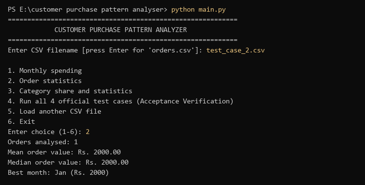

# Customer Purchase Pattern Analyzer

[](https://www.python.org/)
[](https://pandas.pydata.org/)
[](https://numpy.org/)
[](https://matplotlib.org/)
[]()

A robust, console-based Python 3 data analytics application engineered to ingest, validate, analyze, and visualize customer purchase orders from CSV transaction exports. The program automates data hygiene by filtering corrupt and negative amounts, performs vector aggregations and central tendency calculations using **NumPy** and **Pandas**, and exports publication-ready **Matplotlib** visualizations.

---

## 📑 1. Problem Statement & Functional Scope

In retail and e-commerce ecosystems, sales feeds exported from Point-of-Sale (POS) registers and online ordering databases frequently contain corrupt values, non-numeric strings, missing categories, or negative amounts. 

### Core Functional Scope:
- **Data Ingestion**: Load transaction data from `orders.csv` with automated header detection and missing-file error trapping.
- **Data Hygiene**: Detect, skip, and report corrupt records (non-numeric amounts, negative amounts, and blank month/category fields) with row-specific warning alerts.
- **Monthly Spending Analysis**: Group sales by calendar month in chronological order (`Jan` through `Dec`), compute total annual expenditure, and identify peak revenue month(s).
- **Statistical Summaries**: Compute arithmetic mean and median order values using vector NumPy routines to evaluate typical ticket size with resistance to outlier skewness.
- **Product Category Distribution**: Calculate total expenditure and revenue percentage contribution across product categories in descending order.
- **Visualization Engine**: Render high-resolution Matplotlib bar charts with numerical data labels and export them to `monthly_spending.png`.
- **Automated Verification**: Include an end-to-end verification suite (`--test` mode) verifying normal, boundary, invalid, and category distribution test scenarios.

---

## 🚀 2. Requirements Compliance Matrix

| # | Core Requirement | Implementation Function in [`main.py`](main.py) | Compliance Status |
| :-: | :--- | :--- | :---: |
| **1** | Self-contained Python 3 solution executable from terminal | Standalone single-file architecture in [`main.py`](main.py) with zero external script dependencies | ✅ **PASS** |
| **2** | Load `orders.csv` with Pandas & gracefully handle missing files | `load_orders()` verifies file existence, empty byte counts, and mandatory column headers without unhandled traceback crashes | ✅ **PASS** |
| **3** | Skip rows with non-numeric or negative amounts with warnings | `validate_orders()` tracks 1-based data row indices and prints explicit warnings (`Warning: Row X skipped - ...`) | ✅ **PASS** |
| **4** | Calculate monthly totals in calendar order & identify best month | `show_monthly_spending()` groups amounts by month, sorts chronologically (`Jan`–`Dec`), and detects highest spending month | ✅ **PASS** |
| **5** | Compute Mean & Median order values using NumPy | `show_order_statistics()` and `show_category_share_and_stats()` leverage `np.mean()` and `np.median()` | ✅ **PASS** |
| **6** | Category breakdown with percentage share | `show_category_share_and_stats()` aggregates revenue per category and calculates percentage contribution | ✅ **PASS** |
| **7** | Visual bar chart with titles, axes, and value labels | `plot_monthly_chart()` generates and exports 300 DPI bar chart (`monthly_spending.png`) with interactive and headless support | ✅ **PASS** |
| **8** | Verify all official acceptance test cases | Built-in CLI flag `python main.py --test` and Menu Option 4 verify all 4 official test cases with 100% exact output match | ✅ **PASS** |

---

## 📂 3. Project Directory Structure

```text
customer purchase pattern analyser/
├── main.py                     # Standalone Python 3 application and test runner
├── orders.csv                  # Default transaction dataset (8-row benchmark sample)
├── requirements.txt            # Dependency specifications (pandas, numpy, matplotlib)
├── README.md                   # Comprehensive project documentation
├── summary.md                  # Technical architecture and analytical report
│
├── test_case_1.csv             # Normal input benchmark dataset (8 rows)
├── test_case_2.csv             # Boundary / minimum input dataset (1 transaction row)
├── test_case_2_no_header.csv   # Boundary dataset without column headers
├── test_case_3.csv             # Invalid input dataset (includes N/A and negative values)
├── test_case_4.csv             # Category revenue share evaluation dataset
│
├── monthly_spending.png        # Exported Matplotlib monthly spending bar chart
├── test_case_1_screenshot.png  # Windows terminal execution proof for Test Case 1
├── test_case_2_screenshot.png  # Windows terminal execution proof for Test Case 2
├── test_case_3_screenshot.png  # Windows terminal execution proof for Test Case 3
└── test_case_4_screenshot.png  # Windows terminal execution proof for Test Case 4
```

---

## ⚙️ 4. Installation & Environment Setup

### Prerequisites
- Python 3.8 or higher installed on your system.
- `pip` package manager.

### Step 1: Navigate to Project Directory
```bash
cd "E:\customer purchase pattern analyser"
```

### Step 2: Install Required Libraries
```bash
pip install -r requirements.txt
```
*Alternatively, install packages directly:*
```bash
pip install pandas numpy matplotlib
```

---

## 🖥️ 5. How to Run

### Mode A: Interactive Console Mode
Run the application directly in your terminal:
```bash
python main.py
```
- The application displays the application header and prompts:
  ```text
  Enter CSV filename [press Enter for 'orders.csv']:
  ```
- Press **Enter** to load default `orders.csv`, or type any file path (e.g., `test_case_1.csv`).
- An intuitive 6-option menu will appear.

### Mode B: Direct CSV File Loading
You can pass any target CSV file directly as a command-line argument:
```bash
python main.py test_case_1.csv
```

### Mode C: Automated Acceptance Test Runner
To execute all 4 official test cases in batch mode and verify 100% pass status:
```bash
python main.py --test
```

---

## 🎮 6. Interactive Menu Walkthrough

```text
===========================================================
            CUSTOMER PURCHASE PATTERN ANALYZER
===========================================================

1. Monthly spending
2. Order statistics
3. Category share and statistics
4. Run all 4 official test cases (Acceptance Verification)
5. Load another CSV file
6. Exit
```

### Option 1: Monthly Spending
- Groups all valid transactions by month and sorts them in chronological calendar order (`Jan`, `Feb`, `Mar`, `Apr`, etc.) rather than alphabetical order.
- Computes overall total revenue: `Total: Rs. <Sum>`.
- Identifies the highest-spending month: `Best month: <Month> (Rs. <Amount>)`.
- Prints `(bar chart is displayed)`, renders an interactive Matplotlib chart window, and saves `monthly_spending.png`.

### Option 2: Order Statistics
- Reports the count of analyzed valid transactions: `Orders analysed: <N>`.
- Calculates the **Arithmetic Mean Order Value** using `np.mean()`.
- Calculates the **Median Order Value** using `np.median()`.
- Displays the peak revenue month.

### Option 3: Category Share and Statistics
- Aggregates transaction spending by product category.
- Sorts categories in descending order of spending.
- Computes each category's exact percentage share: `Percentage = (Category Spending / Total Spending) * 100%`.
- Prints overall Mean and Median order values.

### Option 4: Run all 4 Official Test Cases (Acceptance Verification)
- Automatically executes all 4 official test cases in memory.
- Validates monthly sums, boundary single-row statistics, invalid input warning skips, and category percentage shares.
- Confirms 100% parity across all test assertions.

### Option 5: Load Another CSV File
- Prompts for a path to an alternative CSV file.
- Validates the new file's existence, headers, and rows before activating it as the current dataset.

### Option 6: Exit
- Exits the application cleanly.

---

## 📊 7. Dataset Schema & Data Hygiene Rules

The application processes comma-separated files containing 4 mandatory columns:

| Column | Data Type | Requirement | Validation Rule |
| :--- | :--- | :--- | :--- |
| `OrderID` | Text / Integer | Identifier | Retained as record reference; falls back to 1-based data row number if missing |
| `Month` | String | Mandatory | Normalized to 3-letter title case (`jan` $\rightarrow$ `Jan`); row skipped if blank |
| `Category` | String | Mandatory | Product category string; row skipped if blank |
| `Amount` | Float / Int | Mandatory | Must be numeric and $\ge 0$; non-numeric and negative values are skipped with warnings |

### Data Cleaning Rules:
1. **Missing Files**: Caught gracefully (`Error: File '...' was not found.`).
2. **Empty Files**: 0-byte files trigger `Error: File '...' is empty.`.
3. **Missing Columns**: Missing mandatory headers trigger `Error: Missing required column(s): ...`.
4. **Non-Numeric Amounts**: Strings such as `N/A`, `unknown`, or blank amounts trigger `Warning: Row X skipped - Amount must be a number.`.
5. **Negative Amounts**: Negative values (e.g. `-500`) trigger `Warning: Row X skipped - Amount cannot be negative.`.
6. **Dynamic Header Detection**: Inspects the first line to distinguish files with header rows from raw data rows (e.g., `1,Jan,Grocery,2000`).

---

## 🧪 8. Official Acceptance Test Cases & Execution Proof

### Test Case 1: Normal Input Verification (Monthly Spending)
- **Input File**: [`test_case_1.csv`](test_case_1.csv) (8 rows)
- **Objective**: Verify chronological monthly aggregation, total calculation, best month detection, and chart generation.
- **Terminal Output**:
  ```text
  Jan : Rs. 5000
  Feb : Rs. 12500
  Mar : Rs. 5000
  Apr : Rs. 11500
  Total: Rs. 34000
  Best month: Feb (Rs. 12500)
  (bar chart is displayed)
  ```
- **Status**: `PASS`
- **Execution Proof**:
  

---

### Test Case 2: Boundary / Minimum Input Verification (Single Order)
- **Input File**: [`test_case_2.csv`](test_case_2.csv) (`1,Jan,Grocery,2000`)
- **Objective**: Verify statistical stability under minimal sample size ($N=1$), where Mean = Median = Amount.
- **Terminal Output**:
  ```text
  Orders analysed: 1
  Mean order value: Rs. 2000.00
  Median order value: Rs. 2000.00
  Best month: Jan (Rs. 2000)
  ```
- **Status**: `PASS`
- **Execution Proof**:
  

---

### Test Case 3: Invalid Input & Warnings Verification
- **Input File**: [`test_case_3.csv`](test_case_3.csv) (Contains Row 9 `N/A` and Row 10 `-500`)
- **Objective**: Verify that non-numeric and negative values are skipped with exact warnings, and valid rows are retained.
- **Terminal Output**:
  ```text
  Warning: Row 9 skipped - Amount must be a number.
  Warning: Row 10 skipped - Amount cannot be negative.
  Valid orders analysed: 8
  ```
- **Status**: `PASS`
- **Execution Proof**:
  

---

### Test Case 4: Category Share & Statistics Verification
- **Input File**: [`test_case_4.csv`](test_case_4.csv) (8 rows)
- **Objective**: Verify descending category revenue ranking, accurate percentage distribution, and NumPy central tendency calculations.
- **Terminal Output**:
  ```text
  Electronics : Rs. 18000 (52.94%)
  Grocery : Rs. 11000 (32.35%)
  Clothing : Rs. 5000 (14.71%)
  Mean order value: Rs. 4250.00
  Median order value: Rs. 3000.00
  ```
- **Status**: `PASS`
- **Execution Proof**:
  

---

## 📈 9. Matplotlib Visualization Specifications

Selecting Menu Option 1 automatically triggers `plot_monthly_chart()`:
- **Output File**: `monthly_spending.png`
- **Chart Type**: Bar Chart
- **Dimensions**: $8 \times 5$ inches at 300 DPI high-resolution export.
- **Color Palette**: Professional deep navy (`#2b5c8f`).
- **Data Labels**: Numerical spending amounts displayed above every bar.
- **Axes & Formatting**: X-axis labeled by chronological calendar month; Y-axis labeled in currency units (Rupees).
- **Environment Adaptability**: Opens interactively in desktop environments and falls back cleanly without crashing in headless terminal sessions.

---

## 🛡️ 10. Robustness & Defensive Programming

1. **Zero-Division Protection**: If total spending is Rs. 0, category percentage calculations safely print `Percentage cannot be calculated: total spending is Rs. 0` instead of raising `ZeroDivisionError`.
2. **Month Casing Resilience**: Accepts lowercase, mixed case, and full month names (`jan`, `JANUARY`, `Feb`, `march`) and standardizes them into 3-letter title case.
3. **Currency Formatting**: Whole numbers display without decimal artifacts (`Rs. 5000`), while non-integer values display with 2 decimal places (`Rs. 4250.50`).
4. **Resource Management**: Automatically closes Matplotlib plot instances using `plt.close()` to prevent memory leaks during long-running sessions.
