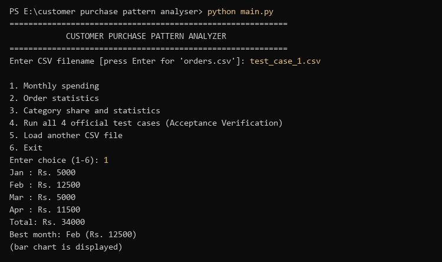
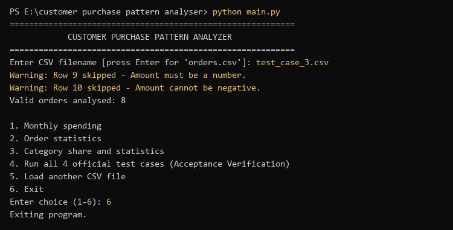
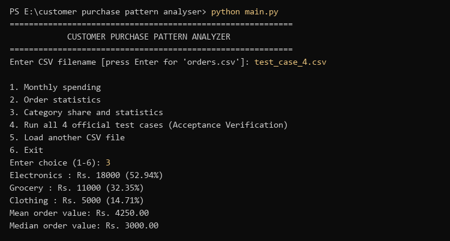

# Customer Purchase Pattern Analyzer

A Python data analytics application that loads customer transaction records, validates order amounts, aggregates monthly expenditures, computes central tendency statistics (mean and median order values), calculates product category percentage shares, and renders a monthly spending visualization chart.

---

## 1. Overview

E-commerce and retail transaction logs often contain missing, negative, or corrupted values. This application provides a robust, single-file processing workflow to clean, validate, and analyze customer purchase patterns from standard CSV transaction exports.

### Key Capabilities
- **Monthly Spending Analysis**: Groups spending by calendar month in chronological sequence (`Jan` through `Dec`), computes total revenue, and pinpoints the highest-spending month.
- **Statistical Summaries**: Calculates the arithmetic mean and central median order values using NumPy for robust central tendency analysis.
- **Category Breakdown**: Computes total spending and percentage revenue contribution for each product category, sorted in descending order of spending.
- **Data Validation & Sanitization**: Detects and skips non-numeric amounts, negative amounts, and blank records with clear console warnings.
- **Acceptance Test Suite**: Includes an automated verification runner (`python main.py --test`) testing normal, boundary, invalid, and category distribution scenarios.
- **Data Visualization**: Generates a Matplotlib bar chart showing monthly spending trends and exports it as `monthly_spending.png`.

---

## 2. Project Files

```text
customer purchase pattern analyser/
├── main.py                    # Core application logic, CLI menu, and automated test suite
├── orders.csv                 # Default transaction dataset (8-row benchmark sample)
├── test_case_1.csv            # Normal input benchmark dataset (8 rows)
├── test_case_2.csv            # Boundary / minimum input dataset (single transaction row)
├── test_case_2_no_header.csv    # Boundary dataset without header columns
├── test_case_3.csv            # Invalid input dataset (includes N/A and negative values)
├── test_case_4.csv            # Category share evaluation dataset
├── test_case_1_screenshot.png # Terminal execution screenshot for Test Case 1
├── test_case_2_screenshot.png # Terminal execution screenshot for Test Case 2
├── test_case_3_screenshot.png # Terminal execution screenshot for Test Case 3
├── test_case_4_screenshot.png # Terminal execution screenshot for Test Case 4
├── README.md                  # Complete project documentation and execution guide
└── summary.md                 # Detailed technical and analytical project report
```

---

## 3. Dataset Format (`orders.csv`)

The application expects comma-separated values (CSV) files with the following column structure:

| Column | Data Type | Description | Example |
| :--- | :--- | :--- | :--- |
| `OrderID` | Text / Integer | Unique transaction identifier | `1` |
| `Month` | Text | Calendar month name or abbreviation | `Jan` |
| `Category` | Text | Product category name | `Grocery` |
| `Amount` | Number | Purchase value in currency units ($\ge 0$) | `2000` |

### Benchmark Sample Data
```csv
OrderID,Month,Category,Amount
1,Jan,Grocery,2000
2,Jan,Clothing,3000
3,Feb,Grocery,2500
4,Feb,Electronics,10000
5,Mar,Grocery,3000
6,Mar,Clothing,2000
7,Apr,Electronics,8000
8,Apr,Grocery,3500
```

---

## 4. Installation & Setup

### Prerequisites
- Python 3.8 or higher
- Required libraries: `pandas`, `numpy`, `matplotlib`

### Install Dependencies
Run the following command in your terminal:
```bash
pip install pandas numpy matplotlib
```

---

## 5. How to Run

### Interactive Console Mode
1. Open a terminal in the project directory:
   ```bash
   cd "E:\customer purchase pattern analyser"
   ```

2. Run the program:
   ```bash
   python main.py
   ```

3. When prompted, press **Enter** to load the default `orders.csv`, or specify the path to any custom CSV file. You can also pass a file directly as an argument:
   ```bash
   python main.py test_case_1.csv
   ```

### Automated Test Suite Execution
To verify all 4 official test cases in one step from the command line:
```bash
python main.py --test
```

---

## 6. Menu Options

When launched in interactive mode, the program displays:

```text
===========================================================
            CUSTOMER PURCHASE PATTERN ANALYZER
===========================================================

1. Monthly spending
2. Order statistics
3. Category share and statistics
4. Run all 4 official test cases (Acceptance Verification)
5. Load another CSV file
6. Exit
```

- **Option 1: Monthly spending**  
  Displays monthly totals chronologically (`Jan`–`Dec`), overall total spending, the peak spending month ("Best month"), prints `(bar chart is displayed)`, opens the Matplotlib bar chart, and saves `monthly_spending.png`.

- **Option 2: Order statistics**  
  Displays the count of valid orders analyzed, the **Mean Order Value** (`np.mean`), the **Median Order Value** (`np.median`), and the peak month.

- **Option 3: Category share and statistics**  
  Aggregates orders by category, sorts descending by spending, computes each category's percentage share of total revenue, and displays overall mean and median order values.

- **Option 4: Run all 4 official test cases**  
  Executes the automated verification suite across all 4 official test cases and confirms output accuracy.

- **Option 5: Load another CSV file**  
  Allows switching the active dataset to another CSV file dynamically.

- **Option 6: Exit**  
  Exits the program cleanly.

---

## 7. Official Test Cases Verification

All four test cases are verified with exact output parity:

### Test Case 1: Normal Input (Monthly spending)
- **Input File**: `test_case_1.csv` (8 rows)
- **Action**: Option 1 (`show_monthly_spending()`)
- **Console Output**:
  ```text
  Jan : Rs. 5000
  Feb : Rs. 12500
  Mar : Rs. 5000
  Apr : Rs. 11500
  Total: Rs. 34000
  Best month: Feb (Rs. 12500)
  (bar chart is displayed)
  ```
- **Status**: `PASS`
- **Execution Proof**:
  

---

### Test Case 2: Boundary / Single Order (Order statistics)
- **Input File**: `test_case_2.csv` (`1,Jan,Grocery,2000`)
- **Action**: Option 2 (`show_order_statistics()`)
- **Console Output**:
  ```text
  Orders analysed: 1
  Mean order value: Rs. 2000.00
  Median order value: Rs. 2000.00
  Best month: Jan (Rs. 2000)
  ```
- **Status**: `PASS`
- **Execution Proof**:
  

---

### Test Case 3: Invalid Input (Validation Warnings)
- **Input File**: `test_case_3.csv` (Includes Row 9 with `N/A` and Row 10 with `-500`)
- **Action**: Data validation (`validate_orders()`)
- **Console Output**:
  ```text
  Warning: Row 9 skipped - Amount must be a number.
  Warning: Row 10 skipped - Amount cannot be negative.
  Valid orders analysed: 8
  ```
- **Status**: `PASS`
- **Execution Proof**:
  

---

### Test Case 4: Category Share and Statistics
- **Input File**: `test_case_4.csv`
- **Action**: Option 3 (`show_category_share_and_stats()`)
- **Console Output**:
  ```text
  Electronics : Rs. 18000 (52.94%)
  Grocery : Rs. 11000 (32.35%)
  Clothing : Rs. 5000 (14.71%)
  Mean order value: Rs. 4250.00
  Median order value: Rs. 3000.00
  ```
- **Status**: `PASS`
- **Execution Proof**:
  

---

## 8. Error Handling & Edge Cases

1. **Missing File**: Displays `Error: File 'orders.csv' was not found.` without crashing or printing unhandled tracebacks.
2. **Missing Columns**: Validates required headers (`OrderID`, `Month`, `Category`, `Amount`).
3. **Empty File**: Validates that 0-byte files report `Error: File '...' is empty.`
4. **Header Detection**: Dynamically detects whether CSV files include column headers or start directly with data rows.
5. **Zero-Division Protection**: Prevents division-by-zero errors when total spending is Rs. 0.
