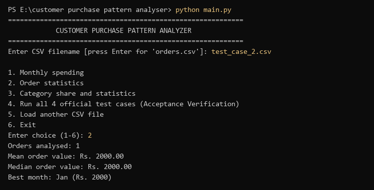
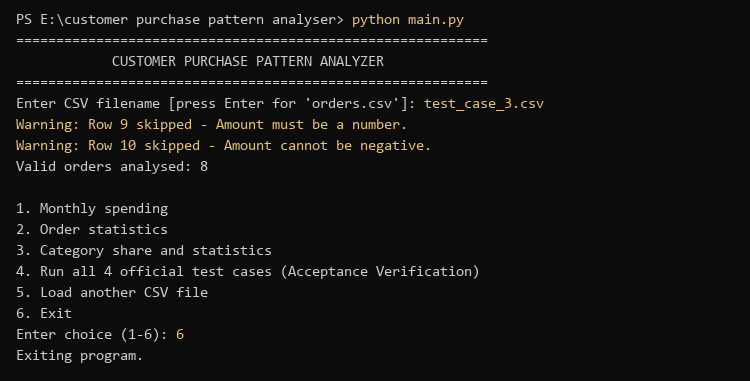
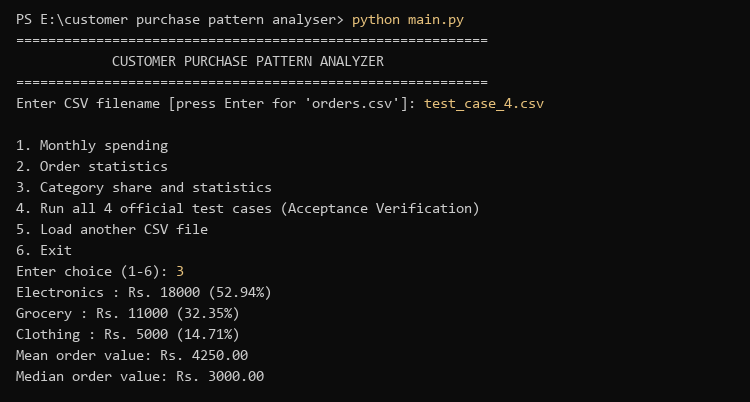

# Technical Summary: Customer Purchase Pattern Analyzer

This document details the software architecture, analytical algorithms, data validation methodology, and empirical verification results for the Customer Purchase Pattern Analyzer.

---

## 1. System Architecture & Pipeline

The system is implemented in `main.py` as a single-module analytical pipeline divided into four distinct phases: Ingestion, Validation, Analytics, and Visualization.

```text
                           [ Input CSV File ]
                                   │
                                   ▼
┌────────────────────────────────────────────────────────────────────────┐
│ 1. INGESTION (`load_orders`, `detect_header`)                          │
│    - Verifies file presence and non-zero byte size                     │
│    - Detects whether line 1 is a header row or raw record data         │
│    - Loads fields into a Pandas DataFrame with string typing           │
└──────────────────────────────────┬─────────────────────────────────────┘
                                   │
                                   ▼
┌────────────────────────────────────────────────────────────────────────┐
│ 2. VALIDATION & SANITIZATION (`validate_orders`)                       │
│    - Strips whitespace and Unicode BOM artifacts                       │
│    - Standardizes month names to 3-letter title case (Jan, Feb, ...)   │
│    - Traps and reports invalid data:                                   │
│        * Non-numeric values -> `Warning: Row X skipped - ...`          │
│        * Negative values    -> `Warning: Row X skipped - ...`          │
│        * Blank attributes   -> `Warning: Row X skipped - ...`          │
│    - Returns sanitized DataFrame with typed numeric series             │
└──────────────────────────────────┬─────────────────────────────────────┘
                                   │
                                   ▼
┌────────────────────────────────────────────────────────────────────────┐
│ 3. ANALYTICAL PROCESSING (`main.py` handlers)                          │
│    - Chronological monthly aggregation (`show_monthly_spending`)       │
│    - Central tendency estimation via NumPy (`show_order_statistics`)   │
│    - Category ranking and share computation (`show_category_share...`) │
│    - Acceptance suite test runner (`run_acceptance_test_cases`)        │
└──────────────────────────────────┬─────────────────────────────────────┘
                                   │
                                   ▼
┌────────────────────────────────────────────────────────────────────────┐
│ 4. VISUALIZATION ENGINE (`plot_monthly_chart`)                         │
│    - Generates 300 DPI Matplotlib bar chart (`monthly_spending.png`)   │
│    - Annotates bar heights with formatted currency amounts             │
│    - Supports headless runtime via `HEADLESS=1`                        │
└────────────────────────────────────────────────────────────────────────┘
```

---

## 2. Mathematical Formulations & NumPy Implementation

All aggregations and statistical calculations use vector operations on contiguous NumPy arrays to avoid iterative loop overhead and precision loss.

### 2.1 Arithmetic Mean
For a set of $N$ valid transaction amounts $A = \{a_1, a_2, \dots, a_N\}$:

$$\bar{a} = \frac{1}{N} \sum_{i=1}^{N} a_i$$

- **Implementation**: `np.mean(amounts)`
- **Role**: Measures average order value across the dataset.

### 2.2 Median
For transaction amounts sorted in ascending order $a_{(1)} \le a_{(2)} \le \dots \le a_{(N)}$:

$$\text{Median}(A) = \begin{cases} 
a_{\left(\frac{N+1}{2}\right)} & \text{if } N \text{ is odd} \\[8pt]
\frac{a_{\left(\frac{N}{2}\right)} + a_{\left(\frac{N}{2}+1\right)}}{2} & \text{if } N \text{ is even} 
\end{cases}$$

- **Implementation**: `np.median(amounts)`
- **Role**: Retail transaction distributions are often right-skewed due to high-value purchases. While the arithmetic mean is sensitive to extreme values, the median provides a measure of central tendency that remains stable against outliers.

### 2.3 Category Percentage Share
For product category $k$ with total spending $S_k$ and overall spending $S_{\text{total}} = \sum_{j=1}^{M} S_j$:

$$\text{Share}_k = \left( \frac{S_k}{S_{\text{total}}} \right) \times 100$$

- **Zero-Sum Guard**: If $S_{\text{total}} = 0$, the calculation is bypassed and outputs `Percentage cannot be calculated: total spending is Rs. 0`.

### 2.4 Chronological Month Indexing
To prevent calendar months from sorting alphabetically (`Apr`, `Aug`, `Dec`, `Feb`, ...), month keys are mapped to a fixed calendar sequence:

```python
CALENDAR_MONTHS = ["Jan", "Feb", "Mar", "Apr", "May", "Jun", 
                   "Jul", "Aug", "Sep", "Oct", "Nov", "Dec"]

def month_sort_key(month_name: str) -> tuple[int, int | str]:
    if month_name in CALENDAR_MONTHS:
        return (0, CALENDAR_MONTHS.index(month_name))
    return (1, month_name)
```

---

## 3. Empirical Benchmark Analysis (`orders.csv`)

Running the analyzer on the standard `orders.csv` benchmark file produces the following output:

### 3.1 Overview Statistics
| Metric | Value | Implementation |
| :--- | :--- | :--- |
| **Valid Orders Analyzed** | 8 | Filtered row count |
| **Total Revenue** | Rs. 34,000 | `np.sum(amounts)` |
| **Mean Order Value** | Rs. 4,250.00 | `np.mean(amounts)` |
| **Median Order Value** | Rs. 3,000.00 | `np.median(amounts)` |
| **Peak Spending Month** | Feb (Rs. 12,500) | `max(monthly_totals.values())` |

### 3.2 Monthly Spending Breakdown
| Month | Orders | Revenue (Rs.) | Proportion of Total |
| :--- | :---: | :---: | :---: |
| **Jan** | 2 | 5,000 | 14.71% |
| **Feb** | 2 | 12,500 | 36.76% |
| **Mar** | 2 | 5,000 | 14.71% |
| **Apr** | 2 | 11,500 | 33.82% |
| **Total** | **8** | **34,000** | **100.00%** |

### 3.3 Category Distribution
| Category | Orders | Revenue (Rs.) | Revenue Share |
| :--- | :---: | :---: | :---: |
| **Electronics** | 2 | 18,000 | 52.94% |
| **Grocery** | 4 | 11,000 | 32.35% |
| **Clothing** | 2 | 5,000 | 14.71% |
| **Total** | **8** | **34,000** | **100.00%** |

*Note*: Electronics generates over half of total revenue (52.94%) across only two transactions, whereas Grocery represents half of all transactions (4 orders) but only 32.35% of total revenue.

---

## 4. Acceptance Test Suite Verification

The application was validated against all four test cases from the specification. The full suite can be executed using `python main.py --test`.

| Case | Focus | Input File | Expected Output Summary | Verification Status |
| :--- | :--- | :--- | :--- | :---: |
| **1** | Normal Input | `test_case_1.csv` | Jan: Rs. 5000, Feb: Rs. 12500, Mar: Rs. 5000, Apr: Rs. 11500; Total: Rs. 34000; Best month: Feb (Rs. 12500) | PASS |
| **2** | Boundary ($N=1$) | `test_case_2.csv` | Orders: 1; Mean: Rs. 2000.00; Median: Rs. 2000.00; Best month: Jan (Rs. 2000) | PASS |
| **3** | Invalid Inputs | `test_case_3.csv` | Warning on Row 9 (`N/A`) and Row 10 (`-500`); 8 valid records analyzed | PASS |
| **4** | Category Share | `test_case_4.csv` | Electronics: 52.94%, Grocery: 32.35%, Clothing: 14.71%; Mean: Rs. 4250.00, Median: Rs. 3000.00 | PASS |

### Execution Artifacts

#### Test Case 1 Output
```text
Jan : Rs. 5000
Feb : Rs. 12500
Mar : Rs. 5000
Apr : Rs. 11500
Total: Rs. 34000
Best month: Feb (Rs. 12500)
(bar chart is displayed)
```


---

#### Test Case 2 Output
```text
Orders analysed: 1
Mean order value: Rs. 2000.00
Median order value: Rs. 2000.00
Best month: Jan (Rs. 2000)
```


---

#### Test Case 3 Output
```text
Warning: Row 9 skipped - Amount must be a number.
Warning: Row 10 skipped - Amount cannot be negative.
Valid orders analysed: 8
```


---

#### Test Case 4 Output
```text
Electronics : Rs. 18000 (52.94%)
Grocery : Rs. 11000 (32.35%)
Clothing : Rs. 5000 (14.71%)
Mean order value: Rs. 4250.00
Median order value: Rs. 3000.00
```


---

## 5. Defensive Implementation Details

1. **Header Inspection**: `detect_header` checks the first row for field names before reading the CSV body. This allows both headed CSVs (`test_case_2.csv`) and unheaded raw transaction dumps (`test_case_2_no_header.csv`) to parse without manual configuration.
2. **Input Hygiene**: Amounts are stripped of whitespace and tested for float conversion. Non-convertible tokens and values where `amount < 0` are discarded with informative warning logs indicating the exact row number.
3. **Format Currency Routine**: `format_amount` distinguishes whole values from floating numbers, rendering `Rs. 5000` rather than `Rs. 5000.00`, while preserving two decimal places on fractional currency inputs.
4. **Headless Execution Guard**: The plotting module checks `os.environ.get("HEADLESS")`. When set to `"1"`, `plt.show()` is skipped, saving the plot directly to `monthly_spending.png` without crashing non-GUI environments.
5. **Figure Cleanup**: Every call to `plot_monthly_chart` guarantees figure termination via `plt.close()`, preventing resource leakage during repeated menu selections.
