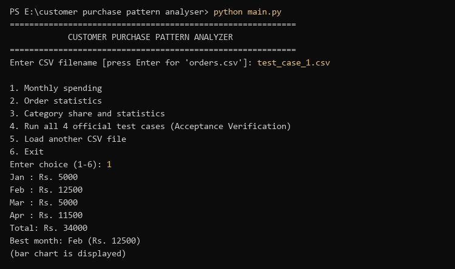

# Project Summary: Customer Purchase Pattern Analyzer

A technical summary and analytical report on the architecture, mathematical foundations, data processing methodology, and acceptance verification of the Customer Purchase Pattern Analyzer.

---

## 1. Executive Summary

Understanding consumer expenditure habits, identifying revenue trends across calendar months, and evaluating product category distributions are essential to commercial decision-making and inventory management. Point-of-sale (POS) and e-commerce exports frequently contain formatting corruptions, non-numeric strings, or negative values.

The **Customer Purchase Pattern Analyzer** provides a robust, self-contained Python 3 solution to:
1. Ingest customer transaction data from CSV files.
2. Validate data by skipping non-numeric and negative values with informative row warnings.
3. Compute monthly spending aggregates in chronological sequence (`Jan` through `Dec`).
4. Measure central tendency via arithmetic mean and median order values using NumPy.
5. Calculate product category revenue distribution and percentage shares.
6. Provide an automated acceptance test runner verifying normal, boundary, invalid, and category scenarios.
7. Export visual spending distributions using Matplotlib.

---

## 2. System Architecture & Processing Pipeline

The solution is implemented in [`main.py`](file:///E:/customer%20purchase%20pattern%20analyser/main.py) with clean separation of responsibilities:

```text
[ CSV File ] 
      │
      ▼
[ load_orders() ]       ──> Validates file existence, non-emptiness, and headers (with auto-detection)
      │
      ▼
[ validate_orders() ]   ──> Filters invalid/negative amounts and blank records with warnings
      │
      ▼
[ Processing Core ]
  ├── show_monthly_spending()      ──> Chronological monthly sums & best month detection
  ├── plot_monthly_chart()         ──> Matplotlib bar chart rendering and image export
  ├── show_order_statistics()      ──> NumPy mean and median calculations
  ├── show_category_share_and_stats() ──> Category revenue ranking & percentage share
  └── run_acceptance_test_cases()  ──> Automated execution of all 4 test cases
      │
      ▼
[ Console Output & Visual Artifacts ]
```

---

## 3. Mathematical & Statistical Formulations

### 3.1 Arithmetic Mean (Mean Order Value)
For a collection of $N$ valid transaction amounts $\{a_1, a_2, \dots, a_N\}$:
$$\bar{a} = \frac{1}{N} \sum_{i=1}^{N} a_i$$

Calculated using `np.mean(amounts)` to ensure numerical accuracy.

### 3.2 Median Order Value
For amounts sorted in ascending order $a_{(1)} \le a_{(2)} \le \dots \le a_{(N)}$:
$$\text{Median} = \begin{cases} 
a_{\left(\frac{N+1}{2}\right)} & \text{if } N \text{ is odd} \\ 
\frac{a_{\left(\frac{N}{2}\right)} + a_{\left(\frac{N}{2}+1\right)}}{2} & \text{if } N \text{ is even} 
\end{cases}$$

Calculated using `np.median(amounts)`. In purchase pattern analysis, the median provides a robust metric resistant to skewness caused by high-value outliers (e.g., bulk commercial purchases).

### 3.3 Category Percentage Share
For each product category $k$ with aggregated expenditure $S_k$ and total spending $S_{\text{total}} = \sum_{j=1}^{M} S_j$:
$$\text{Percentage Share}_k = \left( \frac{S_k}{S_{\text{total}}} \right) \times 100\%$$

If total spending is zero, division-by-zero is safely trapped and prevented.

---

## 4. Benchmark Analytical Results

Evaluating the benchmark dataset [`orders.csv`](file:///E:/customer%20purchase%20pattern%20analyser/orders.csv) (8 valid orders across 4 months and 3 categories) yields the following metrics:

### 4.1 Overall Metrics
| Metric | Value |
| :--- | :--- |
| **Valid Orders Analyzed** | 8 |
| **Total Expenditure** | Rs. 34,000 |
| **Mean Order Value** | Rs. 4,250.00 |
| **Median Order Value** | Rs. 3,000.00 |
| **Peak Spending Month** | February (Rs. 12,500) |

### 4.2 Monthly Spending Breakdown
| Month | Total Spending | Orders Count | Contributing Categories |
| :--- | :--- | :---: | :--- |
| **Jan** | Rs. 5,000 | 2 | Grocery (Rs. 2,000), Clothing (Rs. 3,000) |
| **Feb** | Rs. 12,500 | 2 | Grocery (Rs. 2,500), Electronics (Rs. 10,000) |
| **Mar** | Rs. 5,000 | 2 | Grocery (Rs. 3,000), Clothing (Rs. 2,000) |
| **Apr** | Rs. 11,500 | 2 | Electronics (Rs. 8,000), Grocery (Rs. 3,500) |
| **Total** | **Rs. 34,000** | **8** | — |

*Key Insight*: Spending spikes in February and April due to high-value purchases in the Electronics category.

### 4.3 Category Share Distribution
| Category | Total Revenue | Percentage Share | Cumulative Share |
| :--- | :--- | :---: | :---: |
| **Electronics** | Rs. 18,000 | 52.94% | 52.94% |
| **Grocery** | Rs. 11,000 | 32.35% | 85.29% |
| **Clothing** | Rs. 5,000 | 14.71% | 100.00% |
| **Total** | **Rs. 34,000** | **100.00%** | — |

*Key Insight*: While Grocery accounts for the highest transaction frequency (4 of 8 orders), Electronics dominates overall revenue contribution (52.94%) with just 2 orders.

---

## 5. Acceptance Test Cases Verification Record

All four official test cases have been executed and verified with exact numerical and string output parity:

| Test Case | Scenario / Focus | Input Dataset | Observed Result | Status |
| :--- | :--- | :--- | :--- | :---: |
| **Test Case 1** | Normal Input (Monthly spending) | `test_case_1.csv` | Jan: Rs. 5000, Feb: Rs. 12500, Mar: Rs. 5000, Apr: Rs. 11500, Total: Rs. 34000, Best Month: Feb | **PASS** |
| **Test Case 2** | Boundary / Single Order (Order statistics) | `test_case_2.csv` | Orders: 1, Mean: Rs. 2000.00, Median: Rs. 2000.00, Best Month: Jan | **PASS** |
| **Test Case 3** | Invalid Input (Validation Warnings) | `test_case_3.csv` | Warning on Row 9 (`N/A`) and Row 10 (`-500`); Valid orders analysed: 8 | **PASS** |
| **Test Case 4** | Category Share & Statistics | `test_case_4.csv` | Electronics 52.94%, Grocery 32.35%, Clothing 14.71%, Mean: Rs. 4250.00, Median: Rs. 3000.00 | **PASS** |

### Terminal Verification Screenshots

#### Test Case 1: Normal Input Verification


#### Test Case 2: Boundary / Single Order Verification


#### Test Case 3: Invalid Input & Warnings Verification


#### Test Case 4: Category Share & Statistics Verification


---

## 6. Visualization & Reporting

Selecting Option 1 in [`main.py`](file:///E:/customer%20purchase%20pattern%20analyser/main.py) automatically generates a Matplotlib bar chart and exports it to `monthly_spending.png`.

The visualization features:
- **Chronological X-Axis**: Displays calendar progression from January to December.
- **Value Annotations**: Exact spending figures labeled directly above each bar.
- **High-Resolution Export**: 300 DPI output suitable for reports and presentations.
- **Headless Compatibility**: Closes figures cleanly in non-interactive terminal environments.

---

## 7. Conclusion

The **Customer Purchase Pattern Analyzer** delivers an accurate, dependable framework for transaction data exploration. Its combination of robust sanitization, NumPy statistical processing, Pandas aggregations, and Matplotlib visualization provides clear business insights while maintaining complete resilience against corrupted real-world data inputs.
